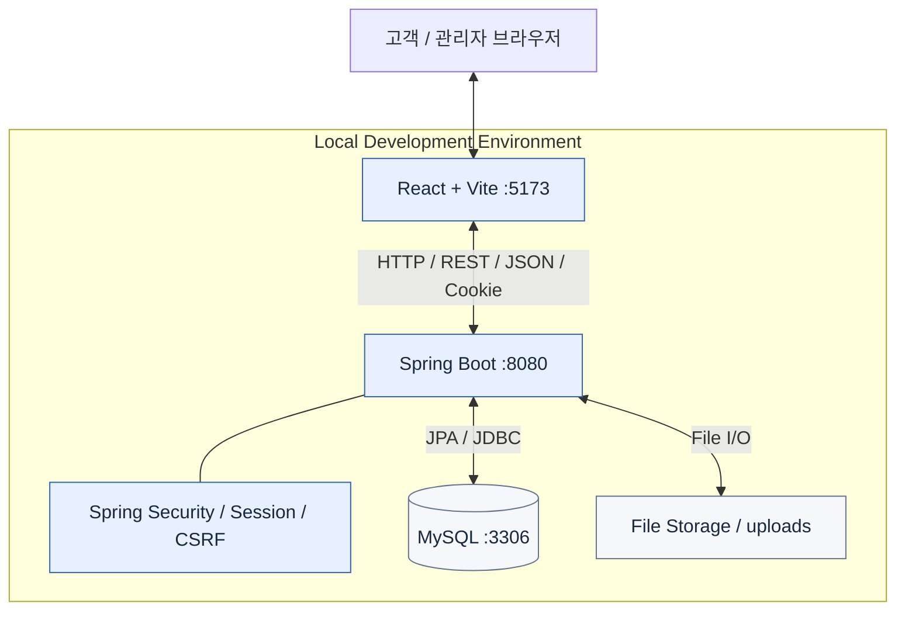
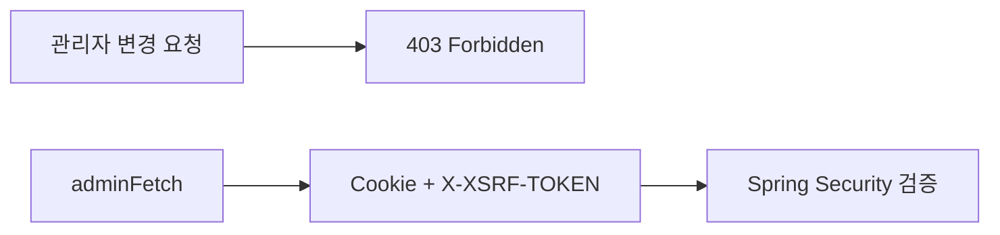
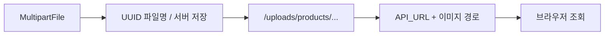

<div align="center">

# EVERPS
### Office Equipment Rental Platform

**사무기기 렌탈 서비스 및 관리자 통합 관리 시스템**


2026.06.29 ~ 2026.09.11 · 개인 프로젝트 · 로컬 실행 환경

[프로젝트 소개](#project-overview) · [시스템 구성](#system-architecture) · [문제 해결](#troubleshooting) · [실행 방법](#getting-started)

</div>

---

## Project Overview

사무기기 렌탈 상품 조회 및 상담 신청을 지원하는 고객 서비스와 상품·상담을 관리하는 관리자 시스템을 구현했습니다. 요구사항 정의부터 프론트엔드, 백엔드, 데이터베이스 연동 및 인증 설정까지 개인으로 수행했습니다.

| 항목 | 내용 |
| --- | --- |
| 개발 형태 | 개인 풀스택 프로젝트 |
| 담당 범위 | 기획, UI, REST API, DB 연동, 인증, 파일 처리 |
| 실행 환경 | 로컬 개발 환경 (외부 서버 배포 미수행) |

## Tech Stack

| 구분 | 기술 |
| --- | --- |
| Frontend | React 19, Vite 8, Tailwind CSS 4, TanStack Query, React Router |
| Backend | Java 17, Spring Boot 4.1.0, Spring MVC, Spring Data JPA |
| Database | MySQL |
| Security | Spring Security, BCrypt, Session, CSRF |
| Build & Collaboration | Gradle, npm, Git, GitHub |

## System Architecture



## Project Structure

```text
RentalHomepage/
├── backend/
│   ├── build.gradle
│   ├── src/main/java/com/everps/backend/
│   │   ├── config/
│   │   ├── controller/
│   │   └── entity/
│   ├── src/main/resources/application.properties
│   └── uploads/
└── frontend/
    ├── src/
    │   ├── config/api.js
    │   └── utils/
    │       ├── adminFetch.js
    │       └── imageUrl.js
    ├── package.json
    └── vite.config.js
```

주요 경로만 표시했습니다.

## Database Design

| 주요 엔티티 | 역할 |
| --- | --- |
| Product | 렌탈 상품 정보 및 이미지 경로 |
| Consultation | 고객 상담 신청 정보 |
| ConsultationStatus | 상담 진행 상태 (열거형) |
| Admin | 관리자 계정 정보 |

[엔티티 소스 확인](backend/src/main/java/com/everps/backend/entity)

## Key Features

| 고객 서비스 | 관리자 시스템 |
| --- | --- |
| 상품 검색 및 조건별 필터링 | 상품 등록·수정·삭제 |
| 상품 상세 및 렌탈 정보 조회 | 상품 노출 및 추천 설정 |
| 렌탈 상담 신청 | 상담 목록 및 진행 상태 관리 |
| 상품 이미지 조회 | 이미지 업로드, 관리자 로그인 및 비밀번호 변경 |

## Security

- BCrypt 기반 비밀번호 처리 및 세션 인증
- 관리자 전용 API에 ADMIN 역할 적용
- 변경 요청에 CSRF 토큰 전달 (로그인 및 공개 상담 신청 POST는 예외)
- 세션 만료 30분, 세션 쿠키 HttpOnly 및 SameSite=Lax 설정
- 허용 Origin 기반 CORS 설정
- 이미지 업로드 용량 10MB 제한 및 Content-Type 허용 목록 적용 (파일 내용 검증과는 별개)

[SecurityConfig.java](backend/src/main/java/com/everps/backend/config/SecurityConfig.java)

## Troubleshooting

### 01. CSRF Token & 403 Forbidden

**문제:** 관리자 변경 요청에서 403 오류 발생.

**조치:** CookieCsrfTokenRepository를 적용하고 공통 요청 함수에서 쿠키의 토큰을 읽어 헤더에 전달하도록 구성했습니다.



실제 코드 발췌:

```javascript
const csrfToken = getCookie("XSRF-TOKEN");

if (csrfToken) {
    headers.set("X-XSRF-TOKEN", csrfToken);
}
```

공통 fetch 호출에는 `credentials: "include"`를 적용했습니다. CSRF 보호를 유지하면서 요청 전달 규약을 일원화했습니다.

[adminFetch.js](frontend/src/utils/adminFetch.js)

### 02. React–Spring Boot CORS

**문제:** 서로 다른 포트에서 실행되는 프론트엔드와 API 서버 사이의 통신 오류.

**조치:** 허용 Origin과 HTTP 메서드를 설정하고 API 주소를 환경 변수로 관리했습니다.

```java
registry
        .addMapping("/api/**")
        .allowedOrigins(allowedOrigin)
        .allowedMethods("GET", "POST", "PUT", "PATCH", "DELETE", "OPTIONS")
        .allowedHeaders("*")
        .allowCredentials(true);
```

위 코드는 실제 설정의 줄바꿈을 정리한 발췌입니다.

[WebConfig.java](backend/src/main/java/com/everps/backend/config/WebConfig.java) · [api.js](frontend/src/config/api.js)

### 03. Image Upload & Path

**문제:** 서버 파일 저장 위치와 브라우저 이미지 접근 경로의 불일치.

**조치:** UUID 파일명, 저장 디렉터리 생성, 정적 리소스 매핑 및 프론트엔드 URL 조합을 적용했습니다.



```javascript
if (image.startsWith("/uploads/")) {
    return `${API_URL}${image}`;
}
```

[ImageUploadController.java](backend/src/main/java/com/everps/backend/controller/ImageUploadController.java) · [imageUrl.js](frontend/src/utils/imageUrl.js)

## Getting Started

### Prerequisites

- JDK 17
- Node.js (Vite 8 호환 버전) 및 npm
- MySQL 서버
- Git

### 1. Clone

```bash
git clone https://github.com/kkiho3421/RentalHomepage.git
cd RentalHomepage
```

### 2. Database

MySQL에서 `everps` 데이터베이스를 생성하고 접근 권한이 있는 로컬 계정을 준비합니다.

```sql
CREATE DATABASE IF NOT EXISTS everps CHARACTER SET utf8mb4;
```

### 3. Backend (Windows PowerShell)

```powershell
cd backend
$env:DB_USERNAME="your_db_user"
$env:DB_PASSWORD="your_db_password"
.\gradlew.bat bootRun
```

| 환경 변수 | 설명 |
| --- | --- |
| DB_USERNAME / DB_PASSWORD | 필수 DB 접속 정보 |
| DB_URL | 기본 localhost:3306/everps |
| CORS_ALLOWED_ORIGIN | 기본 http://localhost:5173 |
| UPLOAD_DIR | 기본 uploads |
| SESSION_COOKIE_SECURE | 로컬 HTTP 기본 false |

### 4. Frontend (새 터미널, 저장소 루트)

```powershell
cd frontend
npm install
npm run dev
```

필요한 경우 `frontend/.env.local`에 `VITE_API_URL=http://localhost:8080`을 설정합니다.

- Frontend: http://localhost:5173
- Backend: http://localhost:8080

관리자 기능은 별도로 준비된 관리자 계정이 필요합니다. 실제 비밀번호나 환경 설정 파일의 비밀값은 저장소에 커밋하지 않습니다.

## Retrospective

클라이언트, 서버, 데이터베이스 및 파일 저장소의 연결 구조를 직접 구성하며 인증, 통신, 환경 설정과 파일 접근 경로를 구분하여 문제를 분석하는 경험을 쌓았습니다. 시스템의 안정적인 연동과 유지보수를 고려한 개발의 중요성을 배웠습니다.

---

<div align="center">

**EVERPS · Developed by [kkiho3421](https://github.com/kkiho3421)**

</div>
